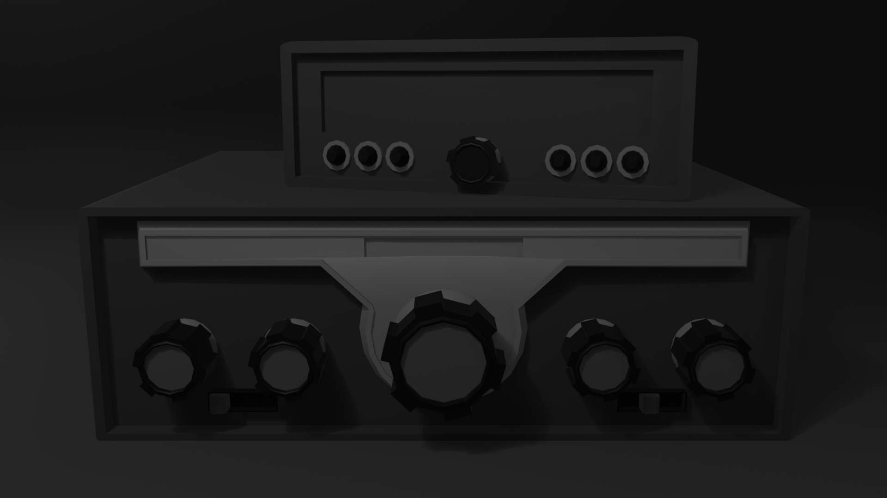

# Vintage Radio Receiver — Blender 3D

A vintage-inspired radio receiver modeled in Blender, focusing on hard-surface modeling, mechanical details, and industrial design.

## Preview

## About the Project

This project is a 3D model of a vintage-style radio receiver featuring multiple rotary knobs, detailed front panels, and rear cable connections. The goal was to create a recognizable industrial design while exploring shapes, proportions, and mechanical details.

## Features

- Dual-unit receiver design
- Detailed rotary control knobs
- Front panel and display elements
- Rear connection panel
- Modeled cable and connectors
- Hard-surface geometry and bevel details

## Tools Used

- Blender

## Project Files

- `Radio_Model.blend` — Original Blender project
- `Radio_Render.png` — Final render

## About the Artist

Hi, I'm Gursehbaj Singh, a 3D artist interested in hard-surface modeling, realistic renders, mechanical objects, and game development.

I enjoy creating detailed 3D models, experimenting with materials and lighting, and improving my skills through personal projects.

I'm continuously learning and building my portfolio, one project at a time.

## Connect

- **GitHub:** [Gursehbaj-Singh](https://github.com/Gursehbaj-Singh)

---

Created by Gursehbaj Singh using Blender.
